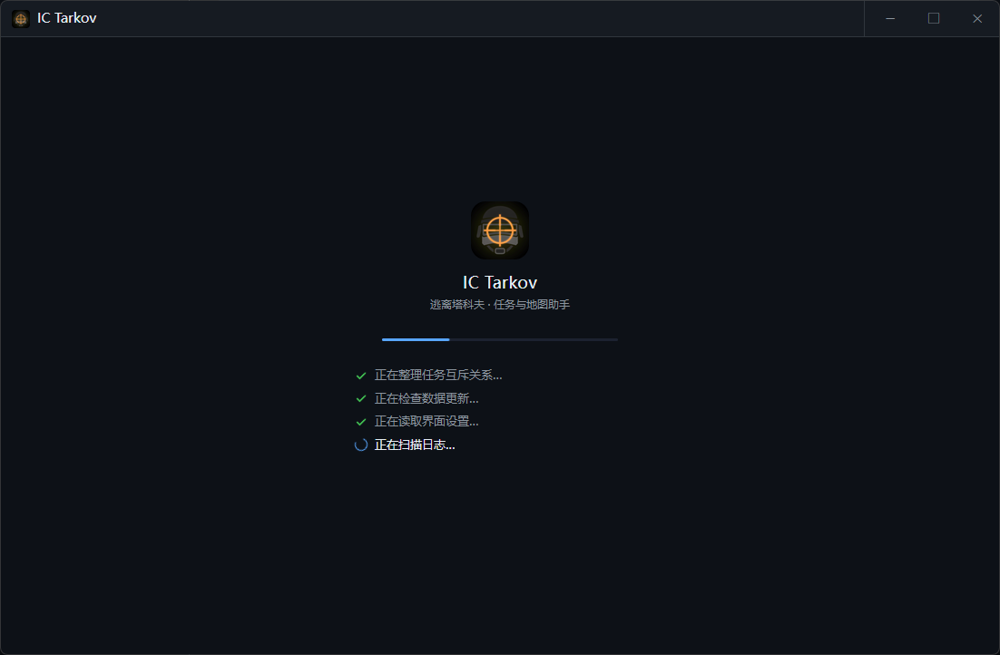
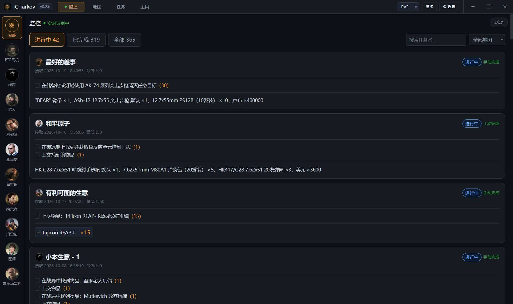
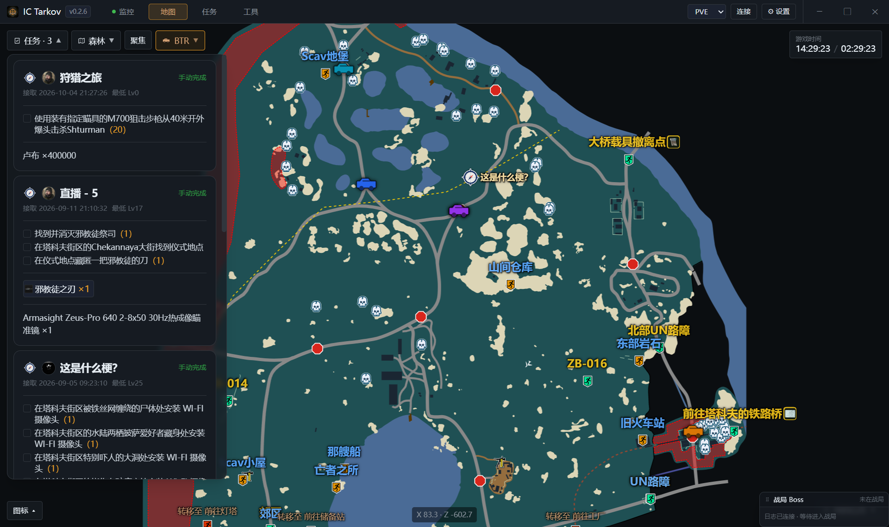
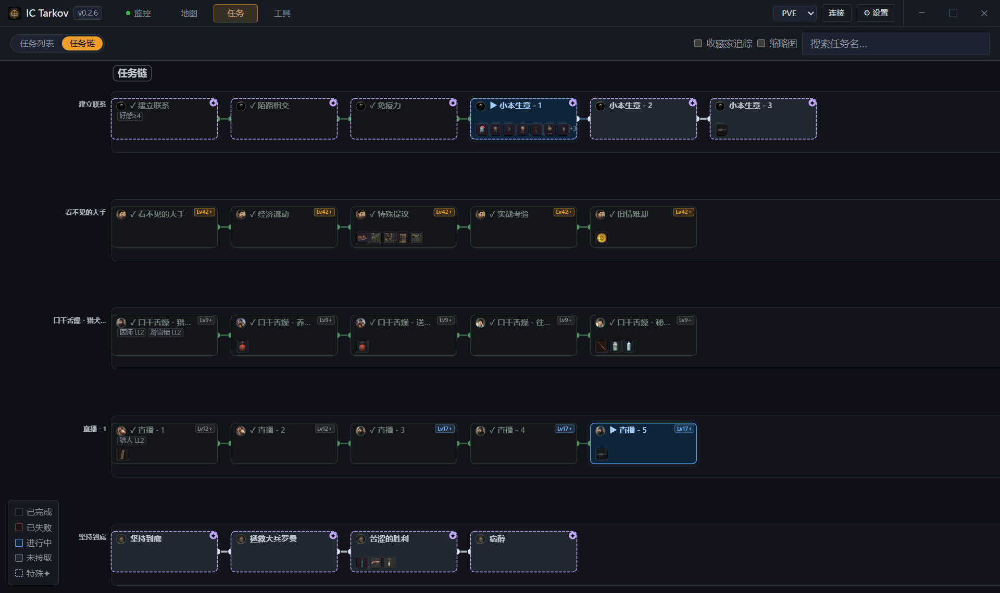
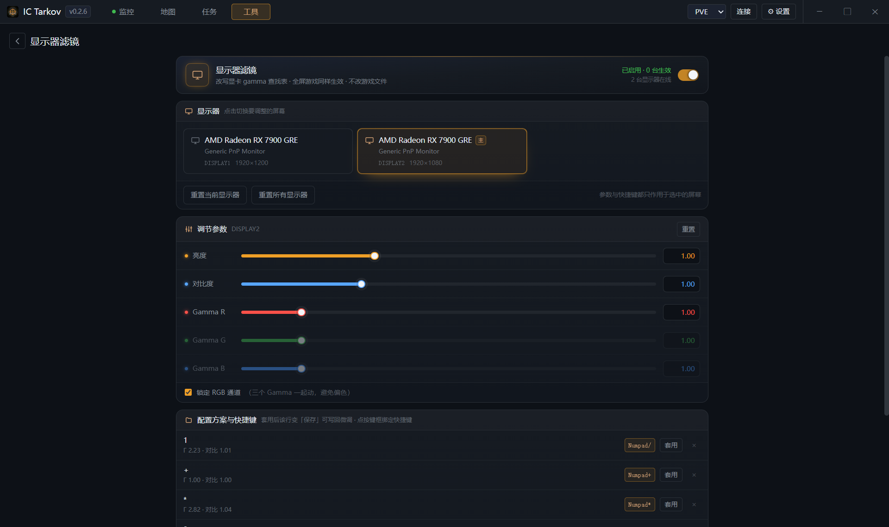
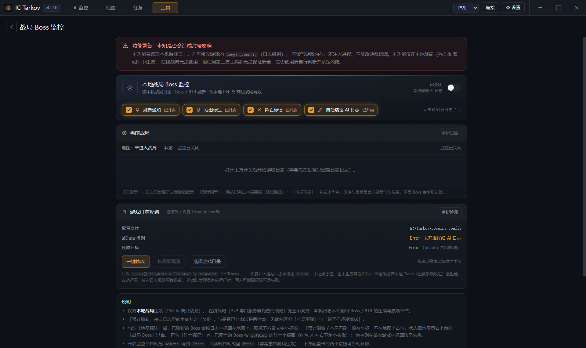

# IC Tarkov

基于 **Tauri 2 + React + TypeScript + Leaflet** 构建的《逃离塔科夫》(Escape from Tarkov) 地图 / 任务 / 战局辅助应用，提供 Windows 桌面端与 Android 版。以官方交互式地图为底图，将玩家坐标改为本地来源进行实时渲染。

> 地图骨架与标记参考 [tarkov-dev](https://github.com/the-hideout/tarkov-dev)（MIT 协议）。

## 功能特性

- **实时定位**：解析游戏截图的玩家坐标，在塔科夫交互式地图上实时渲染当前位置
- **交互式地图**：SVG 线稿 / 瓦片底图、楼层切换、图标分类筛选；任务目标可在地图上直接勾选，钥匙类物品支持「使用位置」一键跳转定位
- **任务监控**：实时监控游戏日志，同步追踪游戏内的任务状态，任务列表与活动动态联动展示
- **任务关系图**：可视化展示任务依赖与商人解锁关系，支持查看任务详情与中文 Wiki
- **战局 Boss 监控**（桌面端、仅本地 / PvE 离线战局）：直接读本机游戏日志，实时显示本局 Boss 是「预计刷新 / 已刷新 / 已死亡 / 不刷」、刷新区域与刷新率、护卫存活数，以及 BTR 状态；可选把刷新点与阵亡点标注到地图（BTR 是移动载具，坐标不准，不在地图上绘制）
- **BTR 路线跟踪**：森林 / 街区 / 灯塔的 BTR 路线、停靠站点与按时间估算的到站信息
- **工具页**：藏身处配方查询（按实时跳蚤价估算成本 / 利润 / 时薪）、物品图鉴、显示器滤镜（改写显卡 gamma，全屏游戏同样生效，可保存方案并绑定全局快捷键）
- **自动更新提示**：启动时检测 GitHub Releases，有新版本时提示；点击可查看更新说明并前往下载
- **收藏家物品管理**：支持收藏家物品的追踪管理，手动勾选已有的物品。
- **移动端（Android）**：提供 Android 版本，手机也能随时查看任务与地图，与桌面端共享同一套数据与交互。
- **局域网同步 / 数据迁移**：手机与电脑通过局域网「同步」功能双向同步任务与收藏；支持将任务状态 / 收藏 / 设置打包为 zip 导入导出，便于备份与跨端迁移。
- **日志重新扫描**：重新扫描日志支持「覆盖」与「补充」两种模式，灵活应对不同存档情况。

> **关于 Boss 监控的风险提示**：该功能只读取本机游戏日志（开启时会按需把游戏目录下 `Logging.config` 里 `aiData` 的日志级别调到 `Trace`，关闭时还原），不读写游戏内存、不注入进程、不修改游戏文件；但无法保证反作弊系统不会将其判定为异常，请自行评估后使用。

## 应用截图








## 数据来源与致谢

- **数据来源**：游戏数据（任务、地图、物品、商人、本地化等）均来自 [tarkov.dev](https://tarkov.dev) 提供的开放接口；中文 Wiki 使用 [eftarkov.com](https://www.eftarkov.com/)，特此致谢。
- **BTR 运动数据**：BTR 的路线、停靠站点与运行时间参考 [eftarkov.com/btr](https://www.eftarkov.com/btr?map=woods)（森林 / 街区 / 灯塔），车辆位置与到站时间按路线与时间推算，仅供参考。
- **Boss 监控参考**：战局 Boss 监控的日志解析思路参考 [seongjin-lab/tarkov-boss](https://github.com/seongjin-lab/tarkov-boss)。
- **项目参考**：本项目的设计与数据解析参考了 [tarkov.dev](https://tarkov.dev) 的社区成果，向其贡献者致谢。

> **Vibe Coding 声明**：本项目在开发过程中深度使用 AI 编程（Vibe Coding）辅助生成与迭代，特此说明。代码可能未经充分人工审查，使用风险自负。

## 开发

### 技术栈

- **前端**：React 18 + TypeScript + Vite + Tailwind CSS
- **桌面壳**：Tauri 2（Rust）
- **地图**：Leaflet + 自定义 Leaflet 控件
- **状态管理**：Zustand
- **数据**：本地 `maps-skeleton.json` + `resources/api`，可离线运行

### 目录结构

```
IC-Tarkov/
├── src-react/                 # 前端 React 源码（页面 / 组件 / 状态）
├── src-tauri/                 # Tauri (Rust) 桌面壳
│   ├── resources/             # 打包携带的游戏数据（api / maps-skeleton.json）
│   └── icons/                 # 应用图标
├── public/                    # 静态资源（maps/ 线稿与瓦片、item-icons/ 物品图标、icons/、data/）
├── assets/                    # 应用图标源文件
├── imgs/                      # README 应用截图
├── scripts/                   # 构建与数据脚本（build-app.mjs / fetch-api-data.mjs / 清 dist / APK 签名）
├── .github/workflows/         # CI：打 tag 后构建 NSIS 安装包与 APK 并创建 Release
├── RELEASE_NOTES.md           # 发布说明（GitHub Release 正文）
├── AGENTS.md                  # AI 协作约定（Vibe Coding）
├── index.html                 # Vite 入口 HTML
├── package.json               # npm 脚本与依赖
└── vite.config.ts / tailwind.config.js / tsconfig*.json / postcss.config.js  # 前端工程配置
```

### 环境要求

- **Node.js**（建议 20+）与 npm
- **Rust** 工具链（cargo，需在 PATH 中）
- **Visual Studio 2019/2022 Build Tools**（MSVC 链接器）：Windows 上编译 Rust 前需在已执行 `vcvars64.bat` 的终端里操作，例如「x64 Native Tools Command Prompt for VS」
- **Tauri 2 前置依赖**：WebView2 运行时等，详见 [Tauri 官方文档](https://v2.tauri.app/start/prerequisites/)

### 快速开始

开发模式：

```powershell
npm install
npm run react:dev    # 只起前端开发服务器（http://localhost:1420）
npm run tauri:dev    # 以 Tauri 壳启动（自动带起前端开发服务器）
```

构建发布包：

```powershell
npm run tauri:build            # 抓取种子数据 → 前端构建 → tauri build → NSIS 安装包
npm run tauri:build:nobundle   # 同上，但跳过 NSIS 打包（只出 exe）
npm run rust:build             # 只编 Rust release（跳过前端与安装包，最快）
```

构建产物位置（Rust 使用 Tauri 默认目录，前端输出到 `src-react/dist`；打包目标仅 NSIS）：

- 应用可执行文件：`src-tauri/target/release/ic-tarkov.exe`
- NSIS 安装包：`src-tauri/target/release/bundle/nsis/IC Tarkov_<version>_x64-setup.exe`
- 前端构建产物：`src-react/dist/`

> `tauri:build` 默认先跑 `npm run data:fetch` 抓取最新的 tarkov.dev 数据；离线或想复用已有种子时，可用 `node scripts/build-app.mjs --skip-data`。

### Android 构建

除 Windows 桌面端外，本项目也构建 Android 应用（aarch64 APK）。需自行配置 `JAVA_HOME` / `ANDROID_HOME` / `NDK_HOME`。

```powershell
npm run tauri:android          # 清理 → 同步版本号 → 构建 → 自动签名（apks/IC-Tarkov-arm64.apk）
npm run tauri:android:dev      # 真机 / 模拟器开发调试
```

构建前由 `scripts/sync-android-version.mjs` 从 `src-tauri/Cargo.toml` 同步版本号，构建后由 `scripts/sign-apk.mjs` 完成签名（与 CI 使用同一套签名，可覆盖安装）。

### 脚本说明

| 脚本 | 说明 |
|------|------|
| `npm run tauri:dev` | 以 Tauri 壳启动开发模式 |
| `npm run tauri:build` | 抓取种子数据 + 前端构建 + 桌面应用打包（NSIS） |
| `npm run tauri:build:nobundle` | 同上，但跳过安装包，只出 exe |
| `npm run rust:check` | 只做 Rust 类型 / 借用检查（最快） |
| `npm run rust:build` | 只编 Rust release |
| `npm run react:dev` | 启动 Vite 前端开发服务器 |
| `npm run react:build` | 清空 dist + 类型检查 + 前端生产构建（输出到 `src-react/dist/`） |
| `npm run react:build:fast` | 跳过类型检查的前端构建 |
| `npm run react:preview` | 预览生产构建 |
| `npm run data:fetch` | 抓取 tarkov.dev 数据到 `src-tauri/resources/api` |
| `npm run tauri:android` / `tauri:android:dev` | 构建并自动签名 aarch64 APK / 真机调试 |

### 配置

应用配置位于 `src-tauri/tauri.conf.json`：

- `productName` / `identifier`：应用元信息
- 版本号统一在 `src-tauri/Cargo.toml` 中维护（`tauri.conf.json` / `package.json` 都不写版本，构建与 CI 均从 Cargo.toml 读取）
- `bundle.resources`：打包时携带的本地资源（`resources/api`、`maps-skeleton.json`）
- `bundle.targets`：仅 `nsis`
- 窗口默认尺寸 1100×720，最小 880×560，深色主题，无边框

### 发布流程

1. 把本次更新写进 `RELEASE_NOTES.md`（作为 GitHub Release 正文）
2. 修改 `src-tauri/Cargo.toml` 的 `package.version`，并跑一次 `npm run rust:check` 让 `Cargo.lock` 同步
3. 提交后打与版本一致的 tag 并推送：

```powershell
git tag v<version>
git push origin main
git push origin v<version>
```

`.github/workflows/release.yml` 随后在 Windows runner 上构建 NSIS 安装包并创建 GitHub Release（说明取自 `RELEASE_NOTES.md`），再在 Ubuntu runner 上构建 aarch64 APK 追加到同一 Release；也可在 Actions 面板手动触发。

## 许可

本项目以 MIT 协议开源，详见 [LICENSE](LICENSE)。

地图骨架与标记数据参考 [tarkov-dev](https://github.com/the-hideout/tarkov-dev)（MIT 协议），游戏数据来自 [tarkov.dev](https://tarkov.dev) 与 [eftarkov.com](https://www.eftarkov.com/)，特此致谢。
